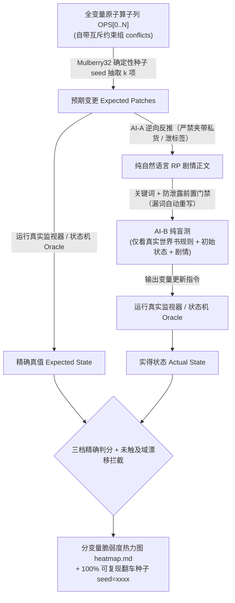

<div align="center">

# MVU-SeedFuzz

**面向 SillyTavern / MVU / 复杂 AI RP 变量框架的“种子驱动逆向真值模糊测试”引擎**  
*Seed-Driven Reverse-Oracle Variable Fuzzing & Vulnerability Heatmap for Complex AI RP Character Cards*

[](https://github.com/yuehe9251-ux/mvu-seedfuzz/actions/workflows/ci.yml)
[](./LICENSE)
[](https://nodejs.org/)
[](#核心特性)
[](./AGENTS.md)

[中文文档](./README.md) · [English README](./README_EN.md) · [AI Agent 接入指南 (`AGENTS.md`)](./AGENTS.md) · [更新日志](./CHANGELOG.md)

</div>

---

## 适用定位与重要说明

> [!IMPORTANT]
> **专为大型复杂变量框架设计（Complex Stateful Variable Frameworks）**  
> 如果你的角色卡只追踪 2~3 个平面数值（如单纯血量 / 好感度），直接人工跑团即可。  
> `MVU-SeedFuzz` 专为拥有 **15~60+ 跨域变量、引用式装备库、负属性 Debuff、后台监视器自动派生结算（抽税 / 经验倍率 / 跨日营收 / 自动回血）与严格 Schema 校验** 的复杂变量卡而设计，专治弱模型或多规则并发时的隐蔽填表漏洞。

> [!NOTE]
> **个人示例声明**：仓库内置的 `presets/minimal-rpg.mjs`、`presets/sillytavern-card-template.mjs` 与 `examples/sample-heatmap.md` **仅为演示机制的个人示例框架**，其字段路径并非统一标准——使用前请务必按下方指南或交由你的 AI Agent 替换为**你自己的变量框架**！

---

## 核心反转思路（Reverse-Oracle Fuzzing）

传统测法是**“先人工写剧情 → 再肉眼/让 AI 猜答案”**，既测不全多变量并发组合，又容易被 AI 裁判的幻觉误导。  
`MVU-SeedFuzz` 彻底反转链路：**以“变量”为源头，用确定性种子随机抽组合算出精确真值，让 AI-A 把真值反译成纯自然语言剧情，再用纯剧情盲测 AI-B，最后交由你自己的代码状态机精确裁判！**



### 与传统测法对比

| 维度 | 人工跑团手测 | 固定题库 + LLM 裁判 | **MVU-SeedFuzz** |
| :--- | :--- | :--- | :--- |
| 多变量并发覆盖 | 极低（只测常见路径） | 有限（依赖手写题库） | **高（确定性种子随机组合全部算子）** |
| 裁判准确度 | 依赖肉眼易漏静默漂移 | AI 裁判自身会算错/幻觉 | **100% 确定性代码状态机裁判（零幻觉）** |
| 复现回归能力 | 无法复现 | 只能重跑死题 | **凭 `seed=xxxx` 一键 100% 精准复现** |
| 能否抓监视器代码 Bug | 很难 | 不能 | **能（`selftest` 阶段即可先抓监视器崩溃）** |
| 量化定位世界书短板 | 纯靠体感 | 粗粒度总分 | **精确到单条变量的命中率热力图** |

---

## 核心特性

- **零第三方依赖**：纯 Node.js（`>= 18`）ESM，下载即跑，无需 `npm install`。
- **框架无关，彻底解耦**：默认内置 RFC-6902 `JSONPatch` + `delta` 解析器；通过 `parseModelOutput` 与 `applyUpdate` 两个钩子，**经典 `_.set`、YAML 状态块、自定义 XML/正则变量框架均可无缝替换**。
- **双护栏防假阳性**：前置门禁自动拦截 AI-A 漏写数字或泄露标签；漂移守卫自动拦截模型覆写父容器清空旧队友/备用装备库。
- **双模并发执行**：
  - **外部 API CLI 模式**：原生兼容所有 OpenAI Chat Completions 端点（DeepSeek / OpenRouter / Ollama / 中转站）与 Google Gemini REST API，支持 `--concurrency N` 并发；
  - **AI Agent 工作流模式**：内置 [`AGENTS.md`](./AGENTS.md) 与 [`workflows/antigravity_fuzz.py`](./workflows/antigravity_fuzz.py)，支持一键交由 Coding Agent 自动适配并并发压测。

---

## 30 秒快速上手

### 1. 运行内置零 Token 自检
```bash
git clone https://github.com/yuehe9251-ux/mvu-seedfuzz.git
cd mvu-seedfuzz
npm test
npm run selftest
```

### 2. 预览确定性种子生成的反推剧情指令
```bash
node src/cli.mjs list-ops --preset presets/minimal-rpg.mjs
node src/cli.mjs gen --preset presets/minimal-rpg.mjs --seed 1001 --k 4
```

### 3. 接入 API 跑 10 种子并发盲测并生成热力图
```bash
node src/cli.mjs run \
  --preset presets/minimal-rpg.mjs \
  --seeds 1001..1010 \
  --k 4 \
  --concurrency 3 \
  --api-url https://api.openai.com/v1/chat/completions \
  --api-key YOUR_API_KEY \
  --model gemini-2.5-flash-lite \
  --story-model gemini-2.5-flash \
  --md-out heatmap.md
```
> 同样支持环境变量 `FUZZ_API_URL` / `FUZZ_API_KEY` / `FUZZ_MODEL`，以及 Google Gemini 原生 `generateContent` 接口。

---

## 如何更换为你自己的变量框架

### 方式一：交给 AI Agent 全自动适配（推荐）
本仓库已内置面向 Antigravity / Claude Code / Cursor / Codex 的专属操作手册 [**`AGENTS.md`**](./AGENTS.md)。直接把本仓库与你的角色卡放在一起，对 Agent 发送：

```text
请先阅读 mvu-seedfuzz/AGENTS.md，然后扫描我的角色卡 Schema、世界书变量规则和监视器脚本，
为我生成专属预设 presets/my-card.mjs，先跑通零 Token 的 selftest，
再帮我盲测 12 个种子并输出分变量脆弱度热力图与世界书优化建议。
```

### 方式二：手动新建 `presets/my-framework.mjs`
复制 [presets/sillytavern-card-template.mjs](./presets/sillytavern-card-template.mjs)，按你的框架实现以下接口：

| 接口字段 | 必填 | 用途说明 |
| :--- | :---: | :--- |
| `createBaseState()` | 必填 | 返回你框架的初始基准 `stat_data`（预置好各类实体以便首轮直接测增删改） |
| `loadRules(options)` | 必填 | 返回盲测时注入 AI-B 的真实规则（可用 `extractWorldbookRulesFromCard` 直读酒馆卡 `.json`） |
| `operators` | 必填 | 把全部可变项写为原子算子列（`conflicts` / `storyFact` / `requiredTokens` / `expectedPatches` / `verify`） |
| `runOracle(state, turn)` | 可选 | 挂载你自己的后台监视器 / 派生结算引擎（可用 `loadEmbeddedMonitor` 直载酒馆助手脚本） |
| `checkDrift(act, base, picked)` | 推荐 | 校验未触及容器防误删/防漂移 |
| `parseModelOutput(rawText)` | 可选 | **非 JSONPatch 框架接入钩子**（如 `_.set` / YAML / 自定义标签），返回 `{ ok, patches, error }` |
| `applyUpdate(base, parsed)` | 可选 | 配合 `parseModelOutput` 应用自定义更新指令，返回 `{ statData, applied, errors }` |

完成后务必先过零 Token 门禁：
```bash
node src/cli.mjs selftest --preset presets/my-framework.mjs
```

---

## 热力图输出样例

完整样例见 [examples/sample-heatmap.md](./examples/sample-heatmap.md)：

| Domain | Operator ID | Variable Mutation | Pass/Total | Hit Rate | Failing Seeds & Diagnostics |
| :--- | :--- | :--- | :---: | :---: | :--- |
| Spatial | `map_spatial_move` | 3D map spatial move command | 0/2 | 🔴 0% | seed=1003(missing spatial rule entry); seed=1005(used landmark ID) |
| Economy | `guild_vault_donate` | Donate currency to guild vault | 1/1 | 🟢 100% | — |
| Gear | `equip_swap_ref` | Reference-based weapon swap | 2/2 | 🟢 100% | — |
| Familiar | `fam_heart_crystal` | Familiar lethal guard -> Heart state | 2/2 | 🟢 100% | — |

---

## 开源协议与贡献

基于 [MIT License](./LICENSE) 开源。欢迎所有 SillyTavern 角色卡作者、MVU 开发者与 AI RP 工具作者提 Issue、分享压测热力图或 PR 贡献新的框架适配预设！
