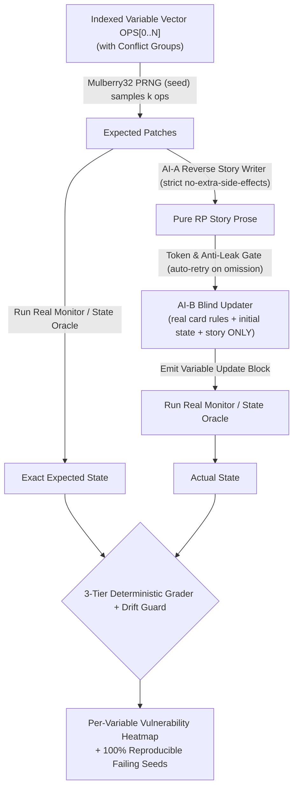

<div align="center">

# MVU-SeedFuzz

**Seed-Driven Reverse-Oracle Variable Fuzzing & Vulnerability Heatmap for Complex AI RP Character Cards**

[](https://github.com/yuehe9251-ux/mvu-seedfuzz/actions/workflows/ci.yml)
[](./LICENSE)
[](https://nodejs.org/)
[](#key-features)
[](./AGENTS.md)

[English](./README_EN.md) · [中文文档](./README.md) · [AI Agent Guide (`AGENTS.md`)](./AGENTS.md) · [Changelog](./CHANGELOG.md)

</div>

---

## Target Scope & Example Disclaimer

> [!IMPORTANT]
> **Built for Complex Stateful Variable Frameworks**  
> If your RP card only tracks 2–3 flat counters (e.g., HP & Affection), manual playtesting is sufficient.  
> `MVU-SeedFuzz` is engineered for **complex variable frameworks** (15–60+ coupled variables, reference-based gear repositories, signed debuffs, background monitor derivations such as guild taxes / EXP multipliers / cross-day revenue, and strict schema validation) where concurrent multi-rule interactions break weak or fast LLMs.

> [!NOTE]
> **Personal Demo Notice**: The bundled `presets/minimal-rpg.mjs`, `presets/sillytavern-card-template.mjs`, and `examples/sample-heatmap.md` are **author-provided illustrative demo frameworks only**—their schemas and paths are NOT fixed standards. Always replace them with your own preset following the guide below.

---

## How It Works (Reverse-Oracle Fuzzing)

Traditional RP testing writes stories first and manually guesses expected variable states—covering few edge cases and inviting noisy `LLM-as-a-Judge` hallucinations.  
**`MVU-SeedFuzz` reverses the pipeline**: start from an indexed variable-mutation vector, sample valid concurrent deltas deterministically via `seed`, compute ground truth through your real code oracle, have **AI-A** synthesize pure RP prose, blind-test **AI-B** on ONLY the prose + real card rules, and grade deterministically!



### Comparison

| Aspect | Manual RP Playtesting | Static Dataset + LLM Judge | **MVU-SeedFuzz** |
| :--- | :--- | :--- | :--- |
| Concurrent multi-variable coverage | Very low | Limited to hand-written cases | **High (PRNG combinations across all operators)** |
| Grading reliability | Prone to missing silent drift | LLM judges hallucinate math | **100% deterministic code oracle** |
| Regression reproducibility | Non-reproducible | Fixed cases only | **Exact replay via `seed=xxxx`** |
| Catches bugs in monitor scripts | Rarely | Never | **Yes (via zero-token `selftest`)** |
| Actionable rule diagnostics | Gut feeling | Coarse score | **Per-variable hit-rate heatmap** |

---

## Key Features

- **Zero dependencies**: Pure Node.js (`>= 18`) ESM — runs immediately with no `npm install`.
- **Framework-agnostic**: Supports RFC-6902 `JSONPatch` + `delta` out of the box, and exposes `parseModelOutput` + `applyUpdate` hooks for **classic `_.set`, YAML blocks, or custom XML/regex DSLs**.
- **Two-layer anti-noise guardrails**: Story pre-gate catches omitted numbers/names or leaked tags; drift guard catches catastrophic parent-container overwrites.
- **Dual execution modes**:
  - Standalone CLI with OpenAI-compatible Chat Completions & Google Gemini REST API support (`--concurrency N`);
  - Native AI Agent onboarding via [`AGENTS.md`](./AGENTS.md) and [`workflows/antigravity_fuzz.py`](./workflows/antigravity_fuzz.py).

---

## Quick Start

```bash
git clone https://github.com/yuehe9251-ux/mvu-seedfuzz.git
cd mvu-seedfuzz
npm test
npm run selftest
```

Run a 10-seed blind fuzz sweep (including optional **Long-Context** distractor stress tests) against any OpenAI-compatible or Gemini endpoint:
```bash
node src/cli.mjs run \
  --preset presets/minimal-rpg.mjs \
  --seeds 1001..1010 \
  --long-seeds 1008..1010 \
  --context-chars 55000 \
  --k 4 \
  --concurrency 3 \
  --api-url https://api.openai.com/v1/chat/completions \
  --api-key YOUR_API_KEY \
  --model gemini-2.5-flash-lite \
  --story-model gemini-2.5-flash \
  --md-out heatmap.md
```
> **Standard vs Long-Context**: Standard seeds model SillyTavern **Extra-Model variable parsing** (rules + `stat_data` + latest turn only). Adding `--long-seeds` + `--context-chars 55000` injects settled prior-turn RP history packed with numerical distractors between the rules and `stat_data`, benchmarking **Main-Model full-history** rule recall & bleed-through resistance (Antigravity workflow auto-chunks >42k-char prompts into multi-turn sessions for zero truncation). You can override the filler via `preset.buildHistoryFiller(seed, targetChars)`.

---

## Replacing with Your Own Variable Framework

### Option A — Let Your AI Coding Agent Adapt It Automatically (Recommended)
Point Antigravity, Claude Code, Cursor, or Codex at [`AGENTS.md`](./AGENTS.md) and your character card:

```text
Read mvu-seedfuzz/AGENTS.md, inspect my character card's schema, worldbook rules, and monitor script,
generate presets/my-card.mjs, pass zero-token `selftest`, then fuzz 12 seeds and report the vulnerability heatmap.
```

### Option B — Author `presets/my-framework.mjs` Manually
Start from [presets/sillytavern-card-template.mjs](./presets/sillytavern-card-template.mjs):
- `createBaseState()` — your card's baseline `stat_data`;
- `loadRules(options)` — your live worldbook / prompt rules (`extractWorldbookRulesFromCard` included);
- `operators[]` — your indexed variable operators (`conflicts`, `storyFact`, `requiredTokens`, `expectedPatches`, `verify`);
- `runOracle(state, turn)` *(optional)* — your real monitor / derived-stat script (`loadEmbeddedMonitor` included);
- `checkDrift(actual, base, picked)` *(recommended)* — detects unintended side-effect drift;
- `parseModelOutput(rawText)` & `applyUpdate(base, parsed)` *(optional)* — override for any non-JSONPatch syntax (`_.set`, YAML, XML, custom DSL).

Verify 100% oracle consistency before spending any LLM tokens:
```bash
node src/cli.mjs selftest --preset presets/my-framework.mjs
```

---

## License

[MIT](./LICENSE)
